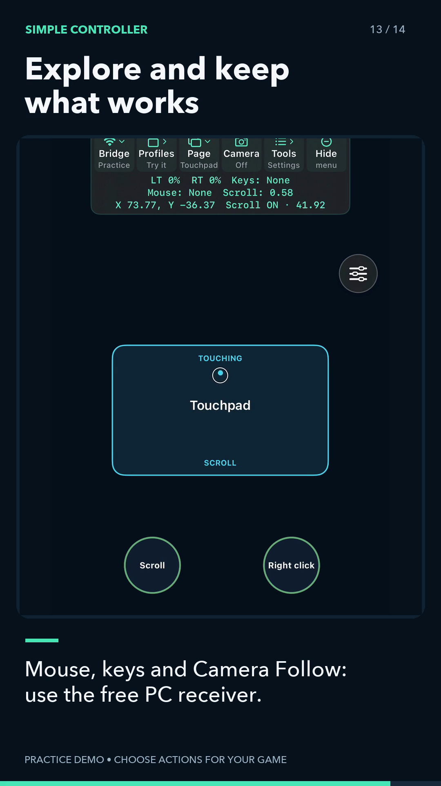

# Beginner videos

Watch or download the silent videos and companion instructions from [Simple Controller releases](https://github.com/kortorder/simplecontroller-android/releases).

- [30-second app preview](Simple-Controller-App-Store-Preview.mp4)
- [3-minute-30-second beginner guide](Simple-Controller-Beginner-Guide.mp4)
- [Written beginner guide](Beginner-Guide.html), [captions](Captions.srt), and [connection FAQ](FAQ.txt)

The videos show the iPhone interface. The Android app includes its own picture guide and some features differ. PC play requires the free receiver software; consoles need a separate compatible controller and bridge.

